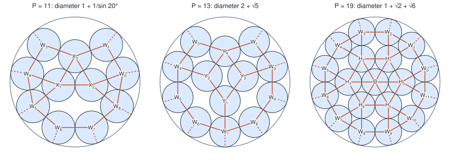
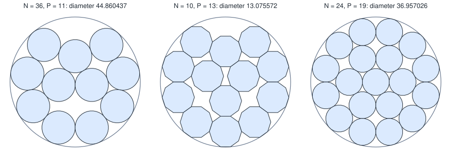
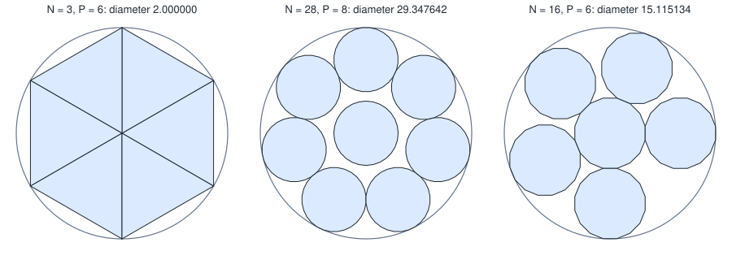

# Regular polygons in a circle: a lower bound and 148 exact optima

**Abstract.** Let $\rho(N,P)$ be the smallest radius of a disc holding $P$ regular $N$-gons of side 1 with disjoint interiors, and $\rho_0(P)$ the smallest radius of a disc holding $P$ unit circles. We prove that for all $N \ge 3$ and $P \ge 1$

$$
\rho(N,P) \;\ge\; \sqrt{r_N^2\,\rho_0(P)^2 + \tfrac14},
$$

where $r_N$ is the inradius of the $N$-gon. The bound is attained when an optimal packing of unit circles, scaled by $r_N$, can have every polygon turned so that it meets each neighbour and the container face-on. That is possible exactly when the contact directions of each circle are congruent modulo $2\pi/N$. Using optimal circle packings that are proved here ($P \le 7$) or in the literature ($P = 8, 9, 11, 13, 19$), we obtain the exact value of $\rho(N,P)$ for 148 pairs with $N \le 100$, listed in [Section 10](#10-table-of-the-148-cases-of-theorem-2). For $P \le 7$ we determine every $N$ for which the bound is attained; for $P = 6$ this adds 30 further $N \le 100$ ([Section 11](#11-table-of-the-30-cases-of-theorem-3)).

**Status.** Proved in this document. Reviewed by independent AI reviewers; not yet reviewed by a human mathematician. See the [changelog](#changelog).

## Contents

1. [Conventions](#1-conventions)
2. [Results](#2-results)
3. [The lower bound](#3-the-lower-bound)
4. [What equality forces, and a construction that attains it](#4-what-equality-forces-and-a-construction-that-attains-it)
5. [Optimal circle configurations](#5-optimal-circle-configurations)
6. [Proof of Theorem 2](#6-proof-of-theorem-2)
7. [Proof of Theorem 3](#7-proof-of-theorem-3)
8. [Proof of Proposition 4](#8-proof-of-proposition-4)
9. [Remarks outside the proof](#9-remarks-outside-the-proof)
10. [Table of the 148 cases of Theorem 2](#10-table-of-the-148-cases-of-theorem-2)
11. [Table of the 30 cases of Theorem 3](#11-table-of-the-30-cases-of-theorem-3)
12. [References](#references)
13. [How to check](#how-to-check)
14. [Changelog](#changelog)

## 1. Conventions

These are PolyPack's conventions (pieces of side 1, unit circles, the score of a circular container is its radius).

**Angles.** $e(\varphi) = (\cos\varphi, \sin\varphi)$ is the unit vector at angle $\varphi$. Angles of points and directions in the configurations of Section 5 are given in degrees; formulas with $\pi/N$ are in radians. Two identities are used throughout: for all $\alpha, \beta$,

$$
e(\beta) - e(\alpha) = 2\sin\tfrac{\beta-\alpha}{2}\; e\!\left(\tfrac{\alpha+\beta}{2} + 90^\circ\right),
\qquad
e(\alpha) + e(\beta) = 2\cos\tfrac{\beta-\alpha}{2}\; e\!\left(\tfrac{\alpha+\beta}{2}\right).
$$

**Pieces.** A piece is a closed regular $N$-gon ($N \ge 3$) of side 1. Its inradius and circumradius are

$$
r_N = \frac{1}{2\tan(\pi/N)}, \qquad R_N = \frac{1}{2\sin(\pi/N)}, \qquad\text{so}\qquad R_N\cos\tfrac{\pi}{N} = r_N,\quad R_N^2 = r_N^2 + \tfrac14,\quad \frac{R_N}{r_N} = \sec\tfrac{\pi}{N}.
$$

A piece with pose $(x, y, \theta)$ has centre $p = (x, y)$ and vertices $v_k = p + R_N\, e(\theta + \pi/2 + 2\pi k/N)$, $k = 0, \dots, N-1$. The face from $v_k$ to $v_{k+1}$ has midpoint $p + R_N\cos(\pi/N)\, e(\theta + \pi/2 + \pi/N + 2\pi k/N)$, so its outward unit normal is

$$
n_k = e\!\left(\theta + \tfrac{\pi}{2} + \tfrac{\pi}{N} + \tfrac{2\pi k}{N}\right),
$$

and the face lies on the line $\lbrace x : (x - p)\cdot n_k = r_N \rbrace$. The piece is $\lbrace x : (x-p)\cdot n_k \le r_N \text{ for all } k \rbrace$. Hence $e(\psi)$ is an outward face normal of the piece if and only if

$$
\theta \equiv \psi - \frac{\pi}{2} - \frac{\pi}{N} \pmod{\frac{2\pi}{N}}. \tag{1.1}
$$

The piece contains its *incircle*, the closed disc of radius $r_N$ about $p$, and is contained in the closed disc of radius $R_N$ about $p$.

**Packings.** A packing of $P$ pieces in a closed disc $D$ is a set of $P$ pieces with pairwise disjoint interiors, each contained in $D$. $\rho(N,P)$ is the infimum of the radii of closed discs holding such a packing, and $\rho_0(P)$ the same for $P$ unit circles (closed discs of radius 1). Both infima are attained (Lemma 0 below), so they are the smallest radii. Theorems 1 and 2 use only that every packing has radius at least the bound and that an explicit packing reaches it; Lemma 0 is used for Theorem 3.

**Circle configurations.** Unit circles centred at $c_1, \dots, c_P$ have disjoint interiors if and only if $\lvert c_i - c_j\rvert \ge 2$ for $i \ne j$, and lie in the closed disc of radius $\rho$ about $O$ if and only if $\lvert c_i\rvert \le \rho - 1$. So an *optimal configuration* for $P$ is a list of points with

$$
\lvert c_i\rvert \le a := \rho_0(P) - 1, \qquad \lvert c_i - c_j\rvert \ge 2 \quad (i \ne j).
$$

In such a configuration, circles $i \ne j$ *touch* if $\lvert c_i - c_j\rvert = 2$, and circle $i$ *touches the wall* if $\lvert c_i\rvert = a$. The *contact directions* of circle $i$ form the set

$$
\Psi_i = \lbrace \arg c_i : \text{if } i \text{ touches the wall} \rbrace \cup \lbrace \arg(c_j - c_i) : j \text{ touches } i \rbrace .
$$

A circle with $\Psi_i = \emptyset$ is a *rattler*. The configuration satisfies the **congruence condition for $N$** if, for every $i$, all elements of $\Psi_i$ are congruent modulo $2\pi/N$.

**The bound.** Throughout,

$$
F(N,P) = \sqrt{r_N^2\,\rho_0(P)^2 + \tfrac14} = \tfrac12\sqrt{\rho_0(P)^2\cot^2(\pi/N) + 1}.
$$

**Lemma 0 (the minima exist).** For every $N \ge 3$ and $P \ge 1$ there is a packing of $P$ pieces (or unit circles) in a closed disc of radius $\rho(N,P)$ (or $\rho_0(P)$).

*Proof.* Take packings in discs centred at $O$ with radii decreasing to the infimum $\rho^\ast$; all radii are at most some $\rho_1$. The poses lie in the compact set $\lbrace \lvert p\rvert \le \rho_1\rbrace \times [0, 2\pi]$, so a subsequence converges. Containment in the closed disc of radius $\rho_k$ passes to the limit as containment in the disc of radius $\rho^\ast$. Two convex pieces $K, K'$ have disjoint interiors if and only if a line separates them [Ro70, Theorem 11.3]. Write such a line as $\lbrace x : n\cdot x = s\rbrace$ with $\lvert n\rvert = 1$, $K \subseteq \lbrace n\cdot x \le s\rbrace$, $K' \subseteq \lbrace n\cdot x \ge s\rbrace$; replacing $s$ by $\max_{x \in K} n\cdot x$ keeps both inclusions and gives $\lvert s\rvert \le \rho_1$. So a further subsequence of the separating lines converges, and the limit line separates the limit pieces. $\square$

## 2. Results

**Theorem 1 (lower bound).** For all $N \ge 3$ and $P \ge 1$, every packing of $P$ regular $N$-gons of side 1 in a closed disc of radius $\rho$ has $\rho \ge F(N,P)$. Hence $\rho(N,P) \ge F(N,P)$.

**Theorem 2 (148 exact values).** Let $P$ and $q_P$ be as in a row of the table below, and let $N \ge 3$ be a multiple of $q_P$. Then there is a packing of $P$ regular $N$-gons in a closed disc of radius $F(N,P)$, so $\rho(N,P) = F(N,P)$, where $\rho_0(P)$ has the value in the table.

| $P$ | $\rho_0(P)$ | decimal | $q_P$ | $N \le 100$ | Count |
|---:|---|---:|---:|---|---:|
| 2 | $2$ | | 2 | every even $N$ from 4 to 100 | 49 |
| 3 | $1 + 2/\sqrt3$ | $= 2.1547005\ldots$ | 12 | 12, 24, …, 96 | 8 |
| 4 | $1 + \sqrt2$ | $= 2.4142135\ldots$ | 8 | 8, 16, …, 96 | 12 |
| 5 | $1 + 1/\sin(\pi/5)$ | $= 2.7013016\ldots$ | 20 | 20, 40, 60, 80, 100 | 5 |
| 6 | $3$ | | 3 | every multiple of 3 from 3 to 99 | 33 |
| 7 | $3$ | | 6 | 6, 12, …, 96 | 16 |
| 8 | $1 + 1/\sin(\pi/7)$ | $= 3.3047648\ldots$ | 28 | 28, 56, 84 | 3 |
| 9 | $1 + 1/\sin(\pi/8)$ | $= 3.6131259\ldots$ | 16 | 16, 32, 48, 64, 80, 96 | 6 |
| 11 | $1 + 1/\sin(\pi/9)$ | $= 3.9238044\ldots$ | 36 | 36, 72 | 2 |
| 13 | $2 + \sqrt5$ | $= 4.2360679\ldots$ | 10 | 10, 20, …, 100 | 10 |
| 19 | $1 + \sqrt2 + \sqrt6$ | $= 4.8637033\ldots$ | 24 | 24, 48, 72, 96 | 4 |

The values of $\rho_0(P)$ for $P \le 7$ are proved in Lemma 5; those for $P = 8, 9, 11, 13, 19$ are taken from the literature (Section 5.2). For $N \le 100$ the theorem covers the 148 pairs $(N,P)$ counted in the table.

[EST: `data/records.json`, from Friedman's Packing Center] Seven of them, $(N,P) = (4,2), (6,2), (8,2), (8,4), (3,6), (6,6), (6,7)$, are listed as optimal ("Trivial") with the same values; the site's sources have no value for the other 141.

**Theorem 3 (all $N$, for $P \le 7$).** Let $1 \le P \le 7$ and $N \ge 3$. Then $\rho(N,P) = F(N,P)$ if and only if

- $P = 1$: always;
- $P = 2, 3, 4, 5, 7$: $q_P \mid N$, with $q_P$ as in Theorem 2;
- $P = 6$: $3 \mid N$, or $N$ is even and $N \notin \lbrace 4, 8, 14 \rbrace$.

For $N \le 100$ this adds to Theorem 2 exactly the 30 pairs $(N, 6)$ with $N$ even, $3 \nmid N$ and $N \ge 10$, $N \ne 14$ (Section 11).

**Proposition 4 (no other $N$ for the chosen configurations).** For each $P$ of Theorem 2, let $C_P$ be the configuration of Section 5 used in the proof. If a packing of $P$ regular $N$-gons in a closed disc of radius $F(N,P)$ has its piece centres at $r_N c_i$, where $(c_i)$ is the image of $C_P$ under an isometry fixing $O$ (the rattler of $P = 8, 9$ may be anywhere), then $q_P \mid N$.

Proposition 4 does not exclude other $N$ for $P \ge 8$: a different optimal configuration of circles could satisfy the congruence condition for further $N$. For $P \le 7$ Theorem 3 settles this; for $P = 6$ it does find further $N$.

## 3. The lower bound

**Lemma 1 (support function).** Let $K$ be a regular $N$-gon with centre $p$, circumradius $R$ and inradius $r$, and let $u$ be a unit vector. Let $\delta \in [0, \pi/N]$ be the angle between $u$ and the nearest outward face normal of $K$. Then

$$
h_K(u) := \max_{x \in K}\,(x - p)\cdot u = R\cos\!\left(\tfrac{\pi}{N} - \delta\right).
$$

In particular $r \le h_K(u) \le R$, and $h_K(u) = r$ if and only if $u$ is an outward face normal of $K$.

*Proof.* A linear function on a polygon attains its maximum at a vertex, and $(v - p)\cdot u = R\cos\gamma$ where $\gamma$ is the angle between $u$ and $v - p$. The directions $v - p$ of the vertices lie midway between consecutive face normals, $2\pi/N$ apart, so the smallest angle between $u$ and a vertex direction is $\pi/N - \delta \in [0, \pi/N]$. Since $\cos$ decreases on $[0, \pi]$, the maximum is $R\cos(\pi/N - \delta)$. It equals $R\cos(\pi/N) = r$ if and only if $\delta = 0$. $\square$

**Lemma 2 (vertex lemma).** Let $K$ be a regular $N$-gon of side 1 with centre $p$, and $D = \lvert p\rvert$. Then

$$
\max_{x \in K}\lvert x\rvert^2 = D^2 + R_N^2 + 2D\,h_K(\hat p) \;\ge\; (D + r_N)^2 + \tfrac14 ,
$$

where $\hat p = p/D$ (the term $2D\,h_K(\hat p)$ is $0$ when $D = 0$). For $D > 0$, equality holds if and only if $\hat p$ is an outward face normal of $K$. For $D = 0$ both sides equal $R_N^2$.

*Proof.* $\lvert x\rvert^2$ is convex, so its maximum over $K$ is attained at a vertex $v$. Every vertex satisfies $\lvert v - p\rvert = R_N$, so $\lvert v\rvert^2 = D^2 + R_N^2 + 2D\,\hat p\cdot(v - p)$, and the maximum of $\hat p\cdot(v-p)$ over the vertices is $h_K(\hat p)$. By Lemma 1, $h_K(\hat p) \ge r_N$, with equality if and only if $\hat p$ is a face normal. Finally $D^2 + R_N^2 + 2Dr_N = (D + r_N)^2 + R_N^2 - r_N^2 = (D+r_N)^2 + \tfrac14$. $\square$

*Remark.* By Lemma 1, $2D\,h_K(\hat p) = 2DR_N\cos(\pi/N - \beta) = 2Dr_N\cos\beta + D\sin\beta$, where $\beta \in [0, \pi/N]$ is the angle between $\hat p$ and the nearest face normal (using $R_N\cos(\pi/N) = r_N$ and $R_N\sin(\pi/N) = \frac12$). In this form the farthest vertex is seen to be an endpoint of the face whose normal is nearest the radial direction.

**Proof of Theorem 1.** Let pieces $K_1, \dots, K_P$ with centres $p_i$ form a packing in the closed disc of radius $\rho$ about $O$, and put $D_i = \lvert p_i\rvert$. Let $B_i$ be the incircle of $K_i$. Since $B_i \subseteq K_i$, the interiors of the $B_i$ are pairwise disjoint, and every $B_i$ lies in the closed disc of radius

$$
\rho' = \max_i\,(D_i + r_N)
$$

about $O$. Scaling by $1/r_N$ gives $P$ unit circles with disjoint interiors in a closed disc of radius $\rho'/r_N$, so $\rho' \ge r_N\,\rho_0(P)$ by the definition of $\rho_0$. Choose $i$ with $D_i + r_N = \rho'$ (any one, if several attain the maximum). By Lemma 2, $K_i$ contains a point $x$ with $\lvert x\rvert^2 \ge \rho'^2 + \frac14$. As $K_i$ lies in the closed disc of radius $\rho$, $\rho^2 \ge \lvert x\rvert^2 \ge \rho'^2 + \frac14 \ge r_N^2\rho_0(P)^2 + \frac14$. $\square$

*Edge cases.* The proof uses no choice of a face when $D_i = 0$ (Lemma 2 covers it). Ties in the maximum are allowed. The container is closed, and only $\lvert x\rvert \le \rho$ for points of the pieces is used. For $P = 1$, $\rho_0(1) = 1$ and $F(N,1) = \sqrt{r_N^2 + 1/4} = R_N$, which one piece centred at $O$ attains, so $\rho(N,1) = R_N$ for every $N$. For $P \ge 2$, $\rho_0(P) \ge 2$ (two points at distance at least 2 cannot both lie in a disc of radius less than 1).

## 4. What equality forces, and a construction that attains it

**Lemma 3 (equality).** Let $P \ge 2$ and $N \ge 3$, and let $K_1, \dots, K_P$ be a packing in the closed disc of radius $F(N,P)$ about $O$, with centres $p_i$. Put $c_i = p_i / r_N$. Then

1. $(c_i)$ is an optimal configuration for $P$;
2. if circle $i$ touches the wall in it, $\arg c_i$ is the direction of an outward face normal of $K_i$;
3. if circles $i$ and $j$ touch in it, $u = (p_j - p_i)/\lvert p_j - p_i\rvert$ is an outward face normal of $K_i$ and $-u$ one of $K_j$.

Consequently $(c_i)$ satisfies the congruence condition for $N$.

*Proof.* (1) Since $K_i$ lies in the disc, Lemma 2 gives $(D_i + r_N)^2 + \frac14 \le F(N,P)^2 = r_N^2\rho_0(P)^2 + \frac14$, so $\lvert c_i\rvert = D_i/r_N \le \rho_0(P) - 1$. The incircles have disjoint interiors, so $\lvert p_i - p_j\rvert \ge 2r_N$, that is $\lvert c_i - c_j\rvert \ge 2$.

(2) If $\lvert c_i\rvert = \rho_0(P) - 1$, then $D_i = r_N(\rho_0(P) - 1) > 0$ and $(D_i + r_N)^2 + \frac14 = F(N,P)^2$. Lemma 2 gives a point of $K_i$ at squared distance at least $F(N,P)^2$ from $O$, with strict inequality unless $\hat p_i$ is a face normal. As $K_i$ lies in the disc, $\hat p_i$ is a face normal.

(3) Let $\lvert p_j - p_i\rvert = 2r_N$, so $u = (p_j - p_i)/(2r_N)$, and let $T = (p_i + p_j)/2 = p_i + r_N u$. Then $T$ lies in both incircles, so in $K_i \cap K_j$. Since $K_i$ and $K_j$ are convex with disjoint interiors, there is a line $\lbrace x : n\cdot x = s\rbrace$ with $\lvert n\rvert = 1$, $K_i \subseteq \lbrace n\cdot x \le s\rbrace$ and $K_j \subseteq \lbrace n\cdot x \ge s \rbrace$ [Ro70, Theorem 11.3]. As $T \in K_i \cap K_j$, $n\cdot T = s$. The incircle of $K_i$ lies in $\lbrace n\cdot x \le s\rbrace$, so

$$
n\cdot p_i + r_N = \max_{\lvert x - p_i\rvert \le r_N} n\cdot x \le s = n\cdot T = n\cdot p_i + r_N\,(n\cdot u).
$$

Hence $n\cdot u \ge 1$, and since both are unit vectors, $n = u$. So every $x \in K_i$ satisfies $(x - p_i)\cdot u \le s - p_i\cdot u = (T - p_i)\cdot u = r_N$, that is $h_{K_i}(u) \le r_N$, and by Lemma 1, $u$ is a face normal of $K_i$. The same argument with $i$ and $j$ exchanged shows that $-u$ is a face normal of $K_j$.

The directions in $\Psi_i$ are therefore all outward face normals of $K_i$, and any two face normals differ by a multiple of $2\pi/N$. $\square$

**Lemma 4 (construction).** Let $N \ge 3$, $a > 0$, and let $c_1, \dots, c_P$ satisfy $\lvert c_i\rvert \le a$ and $\lvert c_i - c_j\rvert \ge 2$ for $i \ne j$. Let $E$ be a set of pairs $\lbrace i,j\rbrace$, and let $W = \lbrace i : \lvert c_i\rvert = a \rbrace$. Put

$$
\Psi_i^E = \lbrace \arg c_i : i \in W\rbrace \cup \lbrace \arg(c_j - c_i) : \lbrace i,j\rbrace \in E \rbrace .
$$

Assume

- (a) for each $i$, the elements of $\Psi_i^E$ are congruent modulo $2\pi/N$;
- (b) $\lvert c_i - c_j\rvert \ge 2\sec(\pi/N)$ for every pair $\lbrace i,j\rbrace \notin E$;
- (c) $\lvert c_i\rvert \le a + 1 - \sec(\pi/N)$ for every $i \notin W$.

Place piece $i$ at centre $p_i = r_N c_i$ with $\theta_i = \psi_i - \pi/2 - \pi/N$ for some $\psi_i \in \Psi_i^E$ (any $\theta_i$ if $\Psi_i^E = \emptyset$). Then the pieces form a packing in the closed disc of radius $\sqrt{r_N^2(a+1)^2 + \frac14}$ about $O$, and if $W \ne \emptyset$ some piece reaches its boundary.

*Proof.* *Face normals.* By (1.1) the face normals of piece $i$ are $e(\psi_i + 2\pi k/N)$. By (a), every direction in $\Psi_i^E$ is one of them.

*Pairs in $E$.* Let $c_j - c_i = d\,u$ with $\lvert u\rvert = 1$ and $d \ge 2$. Then $u$ is a face normal of piece $i$ and $-u$ one of piece $j$ (the direction from $c_j$ to $c_i$ is in $\Psi_j^E$). So piece $i$ lies in $\lbrace x : (x - p_i)\cdot u \le r_N\rbrace$ and piece $j$ in $\lbrace x : (x - p_j)\cdot(-u) \le r_N\rbrace = \lbrace x : (x - p_i)\cdot u \ge r_N d - r_N \rbrace$. Since $r_N d - r_N \ge r_N$, the line $(x - p_i)\cdot u = r_N$ separates the two pieces, so their interiors are disjoint.

*Pairs not in $E$.* Each piece lies in the closed disc of radius $R_N$ about its centre, and its interior in the open disc. By (b), $\lvert p_i - p_j\rvert \ge 2r_N\sec(\pi/N) = 2R_N$, so the open discs, and the interiors, are disjoint.

*Containment.* If $i \in W$, then $\hat p_i = e(\arg c_i)$ is a face normal, so $h_{K_i}(\hat p_i) = r_N$ (Lemma 1) and by Lemma 2 $\max_{x \in K_i}\lvert x\rvert^2 = (D_i + r_N)^2 + \frac14 = r_N^2(a+1)^2 + \frac14$, attained. If $i \notin W$, every point of $K_i$ is within $D_i + R_N \le r_N(a + 1 - \sec\frac{\pi}{N}) + R_N = r_N(a+1)$ of $O$ by (c). $\square$

So if $(c_i)$ is an optimal configuration for $P$ (with $a = \rho_0(P) - 1$) and $E$, $W$ satisfy (a)–(c), the packing has radius at most $F(N,P)$, and by Theorem 1 exactly $F(N,P)$.

Condition (b) forces every touching pair into $E$, since $2 < 2\sec(\pi/N)$; and (c) is a condition only on circles that do not touch the wall. So for an optimal configuration, (a) with $E$ the set of touching pairs is the congruence condition of Section 1, and Lemmas 3 and 4 together say: *the bound is attained with a given optimal configuration if and only if the congruence condition holds, provided the configuration also satisfies (b) and (c).*

## 5. Optimal circle configurations

### 5.1 Up to seven circles

**Lemma 5.** Let $2 \le n \le 7$ and let $c_1, \dots, c_n$ lie in the closed disc of radius $\alpha$ about $O$, with $\lvert c_i - c_j\rvert \ge d$ for $i \ne j$. Then

$$
d \le \alpha\,\max\!\left(1,\, 2\sin\tfrac{\pi}{n}\right).
$$

Consequently $\rho_0(n) = 1 + 1/\sin(\pi/n)$ for $2 \le n \le 6$ and $\rho_0(7) = 3$. Moreover, with $a_n = \rho_0(n) - 1$, every optimal configuration for $n$ is, up to rotation about $O$:

- for $n \le 5$: the regular $n$-gon $a_n\, e(k\cdot 360^\circ/n)$, $k = 0, \dots, n-1$;
- for $n = 6$: either the regular hexagon $2e(60^\circ k)$, or the point $O$ together with five points on the circle of radius 2 whose angular separations are all at least $60^\circ$;
- for $n = 7$: the point $O$ together with the regular hexagon $2e(60^\circ k)$.

*Proof.* *Case 1: some $c_i = O$.* Then $d \le \lvert c_j\rvert \le \alpha$ for any $j \ne i$.

*Case 2: all $c_i \ne O$.* Order the points by their argument; the $n$ angular gaps between consecutive points sum to $2\pi$, so some gap $\gamma$ is at most $2\pi/n$. Let $p, q$ be its endpoints, $x = \lvert p\rvert$, $y = \lvert q\rvert \in (0, \alpha]$. Since $\gamma \le 2\pi/n \le \pi$ and $xy > 0$,

$$
d^2 \le \lvert p - q\rvert^2 = x^2 + y^2 - 2xy\cos\gamma \le f(x,y) := x^2 + y^2 - 2xy\cos\tfrac{2\pi}{n}.
$$

The quadratic form $f$ is convex. For $n \ge 3$ it is strictly convex ($\lvert\cos(2\pi/n)\rvert < 1$), and for $n = 2$, $f = (x+y)^2$; in both cases its maximum over the square $[0,\alpha]^2$ is attained only at vertices. The vertex values are $0$, $\alpha^2$, $\alpha^2$ and $f(\alpha,\alpha) = 2\alpha^2(1 - \cos\frac{2\pi}{n}) = 4\alpha^2\sin^2\frac{\pi}{n}$. Hence $d^2 \le \alpha^2\max(1, 4\sin^2\frac{\pi}{n})$.

*Values.* Unit circles in a disc of radius $\rho$ have centres in the disc of radius $\alpha = \rho - 1$ at mutual distances $d \ge 2$, so $\rho \ge 1 + 2/\max(1, 2\sin\frac{\pi}{n})$. This is $1 + 1/\sin(\pi/n)$ for $n \le 6$ (where $2\sin(\pi/n) \ge 1$) and $3$ for $n = 7$. The configurations listed below attain these radii (Section 5.3).

*Equality, $n \le 5$.* Here $d = 2$, $\alpha = a_n = 1/\sin(\pi/n)$ and $2\sin(\pi/n) > 1$. Case 1 would give $2 \le a_n < 2a_n\sin(\pi/n) = 2$, impossible. In Case 2 every inequality above is an equality for every gap of minimal size $\gamma$: $(x,y)$ is the unique maximising vertex $(\alpha, \alpha)$ and $\cos\gamma = \cos(2\pi/n)$. So the minimal gap is $2\pi/n$; all $n$ gaps are at least $2\pi/n$ and sum to $2\pi$, so all equal $2\pi/n$, all are minimal, and every point has modulus $a_n$.

*Equality, $n = 6$.* Here $d = 2$, $\alpha = 2$, and all four vertex values except $f(0,0)$ equal $4$. In Case 2, equality forces $(x,y)$ to be a maximising vertex with $x, y > 0$, i.e. $(2,2)$, and $\gamma = \pi/3$; as before all gaps equal $60^\circ$ and all points have modulus 2: the regular hexagon. In Case 1, the other five points satisfy $2 \le \lvert c_j\rvert \le 2$, and two points on the circle of radius 2 are at distance $4\sin(\varphi/2) \ge 2$ exactly when their angular separation $\varphi$ is at least $60^\circ$.

*Equality, $n = 7$.* Here $\alpha = 2$ and $f(2,2) = 16\sin^2(\pi/7) < 4$, so the maximum $4$ of $f$ is attained only at $(2,0)$ and $(0,2)$; Case 2 would give $\lvert p - q\rvert < 2$. So Case 1 holds: one point is $O$, and the other six lie on the circle of radius 2 with angular separations at least $60^\circ$, hence exactly $60^\circ$. $\square$

The values for $n \le 7$ are classical: $n = 7$, with uniqueness, is [BE51, Theorem 3] (seven points at mutual distances at least 1 have diameter at least 2, with equality only for a regular hexagon of side 1 and its centre); $n \le 9$ is in [Pi69]; for the attributions of $n \le 6$ and $n = 6, 7$ to [CGG68] and [CS87] see [Fo03, Section 1]. The proof above does not depend on them.

### 5.2 Eight or more circles: the literature

For $P = 8, 9, 11, 13, 19$ the configurations of Sections 5.3–5.6 give $\rho_0(P) \le \rho_P$, where $\rho_P$ is the value in Theorem 2. The reverse inequality is a published theorem in each case. The sources use other normalisations: $d_n$, the largest possible minimum distance of $n$ points in a closed unit disc, or $r_n$, the smallest radius of a disc holding $n$ points at mutual distances at least 1. Scaling gives $\rho_0(n) = 1 + 2/d_n = 1 + 2r_n$.

- **$P = 8, 9$.** Pirl [Pi69] proved that Kravitz's arrangements are optimal for $n \le 9$ [Fo03, Section 1]; [GLNÖ98, Section 1] credits Pirl with optimality up to 10 circles. For $n = 8, 9$ these arrangements are a regular heptagon, respectively octagon, on the boundary and one point at the centre, which are $C_8$ and $C_9$ (Section 5.3). So $\rho_0(8) = 1 + 1/\sin(\pi/7)$ and $\rho_0(9) = 1 + 1/\sin(\pi/8)$, i.e. $d_8 = 2\sin(\pi/7)$ and $d_9 = 2\sin(\pi/8)$. [EST: the content of [Pi69] is taken from [Fo03] and [GLNÖ98], both read for this write-up; [Pi69] itself could not be consulted. Its bibliographic data were checked against Crossref and zbMATH.] Friedman's Packing Center, the source of the site's caption, attributes $P = 8$ to "Braaksma 1963". No published work matching that attribution was found (zbMATH, Crossref, and the reference lists of [Me94], [Fo99], [Fo03] and [GLNÖ98]), so it is not used here.
- **$P = 11$.** Melissen [Me94] proved $d_{11} = 2\sin(\pi/9)$ and determined the only two optimal configurations [zbMATH 0810.52013, review]. So $\rho_0(11) = 1 + 1/\sin(\pi/9)$. [EST: from the review and the publisher's abstract; the full text was not consulted.]
- **$P = 13$.** Fodor [Fo03, Theorem 1] proved $r_{13} = \frac{1 + \sqrt5}{2}$, so $\rho_0(13) = 2 + \sqrt5$. He also proved that every optimal configuration is one of two: a rigid one, and one with ten points in a regular decagon on the boundary and three free points inside. (Theorem 1 prints $r_{13} = (2\sin 36^\circ)^{-1} = \frac{1+\sqrt5}{2}$; the middle expression should read $(2\sin 18^\circ)^{-1}$, as the paper's later use of $r_{13} - 1/r_{13} = 1$ and of the angle $36^\circ = 2\arcsin(1/(2r_{13}))$ confirms.) [EST: full text read.]
- **$P = 19$.** Fodor [Fo99] proved that the densest packing of 19 circles is the conjectured one: one circle at the centre, six around it, and twelve at the vertices of a regular dodecagon [zbMATH 0927.52024, review]. That is $C_{19}$ of Section 5.6, whose radius is $1 + \sqrt2 + \sqrt6$ (in the unit-distance normalisation, $r_{19} = (2\sin 15^\circ)^{-1}$). The proof uses the optimality results for 7, 8, 9 and 10 circles. [EST: from the review and the publisher's abstract; the full text was not consulted.]

### 5.3 Rings: $P = 2, \dots, 9$

For $n \ge 2$ and an angle $\varphi_0$, the ring $\mathcal R_n(\varphi_0)$ is

$$
c_k = a_n\, e(\varphi_k), \qquad \varphi_k = \varphi_0 + k\cdot\tfrac{360^\circ}{n}, \qquad a_n = \frac{1}{\sin(180^\circ/n)}, \qquad k = 0, \dots, n-1 .
$$

By the difference formula, $c_{k+1} - c_k = 2a_n\sin(180^\circ/n)\, e(\varphi_k + 90^\circ + 180^\circ/n) = 2e(\varphi_k + 90^\circ + 180^\circ/n)$: consecutive circles touch, and the direction from $c_k$ to $c_{k+1}$ is $\varphi_k + 90^\circ + 180^\circ/n$; the direction from $c_k$ to $c_{k-1}$ is $\varphi_k - 90^\circ - 180^\circ/n$. Non-consecutive circles $k, l$ are at distance $2a_n\sin(j\cdot 180^\circ/n)$ with $2 \le j = \min(\lvert k - l\rvert, n - \lvert k - l\rvert) \le n/2$, hence at least $2a_n\sin(360^\circ/n) = 4\cos(180^\circ/n)$ (for $n \ge 4$).

The configurations $C_P$ for $P \le 9$ are:

| $P$ | $C_P$ | $a = \rho_0(P) - 1$ | touch the wall | rattlers | non-touching pairs at distance at least |
|---:|---|---|---|---|---|
| 2 | $\mathcal R_2(0^\circ)$: $c_0 = (1,0)$, $c_1 = (-1,0)$ | $1$ | both | none | (no such pair) |
| 3 | $\mathcal R_3(90^\circ)$ | $2/\sqrt3$ | all | none | (no such pair) |
| 4 | $\mathcal R_4(45^\circ)$ | $\sqrt2$ | all | none | $2\sqrt2$ |
| 5 | $\mathcal R_5(90^\circ)$ | $1/\sin 36^\circ$ | all | none | $4\cos 36^\circ = 1 + \sqrt5$ |
| 6 | $\mathcal R_6(0^\circ)$ | $2$ | all | none | $2\sqrt3$ |
| 7 | $\mathcal R_6(0^\circ)$ and $O$ | $2$ | the ring | none | $2\sqrt3$ |
| 8 | $\mathcal R_7(90^\circ)$ and $O$ | $1/\sin(180^\circ/7)$ | the ring | $O$ | $a > 7/\pi > 2.2$ |
| 9 | $\mathcal R_8(22.5^\circ)$ and $O$ | $1/\sin 22.5^\circ$ | the ring | $O$ | $a > 8/\pi > 2.5$ |

In each ring the touching pairs are exactly the consecutive ones (the others are at distance at least $4\cos(180^\circ/n) > 2$ for $n \ge 4$). For $P = 7$ the centre touches all six ring circles ($\lvert c_k\rvert = 2$). For $P = 8, 9$ the centre is at distance $a_n > 2$ from every ring circle (by $\sin x < x$), so it is a rattler; the ring's own non-consecutive pairs are at distance at least $4\cos(180^\circ/n) > 3.6$. In every case all ring circles touch the wall and the centre does not. The radii are $a_n + 1 = \rho_0(P)$: by Lemma 5 for $P \le 7$, and by Section 5.2 for $P = 8, 9$. The numbers $2/\sqrt3 = 1/\sin 60^\circ$, $\sqrt 2 = 1/\sin 45^\circ$ and $2 = 1/\sin 30^\circ$ are $a_3, a_4, a_6$.

**Contact directions.** For a ring circle $c_k$, $\Psi_k$ consists of $\varphi_k$ (the wall) and $\varphi_k \pm (90^\circ + 180^\circ/n)$, and, for $P = 7$, also $\varphi_k + 180^\circ$ (towards $O$). For $P = 7$ the centre has $\Psi_O = \lbrace 60^\circ k \rbrace$. The difference between the two neighbour directions is $180^\circ + 360^\circ/n = 2(90^\circ + 180^\circ/n)$, so the congruence condition holds for a ring circle if and only if $N(90^\circ + 180^\circ/n)/360^\circ = N(n+2)/(4n)$ is an integer, i.e. if and only if

$$
q_n \mid N, \qquad q_n = \frac{4n}{\gcd(4n,\, n+2)} .
$$

This gives $q_2 = 2$, $q_3 = 12$, $q_4 = 8$, $q_5 = 20$, $q_6 = 3$, $q_7 = 28$, $q_8 = 16$. For $P = 2$ the two directions of each circle are $\varphi_k$ and $\varphi_k + 180^\circ$, and the condition is $2 \mid N$. For $P = 7$ the ring circles also need $N \cdot 180^\circ/360^\circ \in \mathbb Z$ and the centre needs $N \cdot 60^\circ / 360^\circ \in \mathbb Z$, so the condition is $\mathrm{lcm}(3, 2, 6) = 6 \mid N$. The rattlers of $P = 8, 9$ impose nothing. So for $2 \le P \le 9$ the congruence condition for $C_P$ holds if and only if $q_P \mid N$ with $q_P$ as in Theorem 2.

### 5.4 Eleven circles



*Figure 1.* The configurations $C_{11}$, $C_{13}$ and $C_{19}$. Solid segments join touching circles; dashed segments mark wall contacts.

Let $a = 1/\sin 20^\circ$, so $\rho_P = 1 + a = 1 + 1/\sin(\pi/9) = 3.9238044\ldots$. The configuration $C_{11}$ consists of

$$
W_k = a\, e(10^\circ + 40^\circ k)\quad (k \in \lbrace 0, 1, 3, 4, 5, 6, 7, 8\rbrace),
\qquad L = (-1, -\tan 10^\circ),\quad R = (1, -\tan 10^\circ),\quad T = (0, \sqrt3 - \tan 10^\circ).
$$

The eight $W_k$ are nine equally spaced positions on the circle of radius $a$ with the one at $90^\circ$ left empty; $L, R, T$ form an equilateral triangle of side 2 below it. Equivalently $L = \sec 10^\circ\, e(190^\circ)$, $R = \sec 10^\circ\, e(-10^\circ)$ and $T = L + 2e(60^\circ)$. The configuration is symmetric under the reflection $\sigma(x,y) = (-x,y)$, which maps an angle $\varphi$ to $180^\circ - \varphi$, swaps $L \leftrightarrow R$, $W_0 \leftrightarrow W_4$, $W_1 \leftrightarrow W_3$, $W_5 \leftrightarrow W_8$, $W_6 \leftrightarrow W_7$, and fixes $T$.

**Identity.** $\sin 20^\circ + \sin 40^\circ = 2\sin 30^\circ\cos 10^\circ = \cos 10^\circ$; multiplying by $a = 1/\sin 20^\circ$ and using $\sin 40^\circ = 2\sin 20^\circ\cos 20^\circ$,

$$
a\cos 10^\circ = 1 + 2\cos 20^\circ. \tag{5.1}
$$

**Contacts.** The following 16 pairs touch, with the stated direction $\psi$ (that is, $c_j - c_i = 2e(\psi)$ for the pair $(c_i, c_j)$):

| pair | $\psi$ | pair | $\psi$ |
|---|---|---|---|
| $(W_k, W_{k+1})$, $k = 0, 3, 4, 5, 6, 7$ | $120^\circ + 40^\circ k$ | $(W_8, W_0)$ | $80^\circ$ |
| $(L, R)$ | $0^\circ$ | $(L, T)$ | $60^\circ$ |
| $(R, T)$ | $120^\circ$ | | |
| $(L, W_4)$ | $160^\circ$ | $(R, W_0)$ | $20^\circ$ |
| $(L, W_5)$ | $220^\circ$ | $(R, W_8)$ | $-40^\circ$ |
| $(T, W_1)$ | $20^\circ$ | $(T, W_3)$ | $160^\circ$ |

*Proof.* Ring: $W_{k+1} - W_k = 2a\sin 20^\circ\, e(10^\circ + 40^\circ k + 20^\circ + 90^\circ) = 2e(120^\circ + 40^\circ k)$, and $W_0 - W_8 = 2e(80^\circ)$ in the same way ($W_0 = a\,e(370^\circ)$). Triangle: $R - L = (2, 0)$, $T - L = (1, \sqrt3)$, $T - R = (-1, \sqrt3)$. For $(L, W_4)$: $e(-170^\circ)(W_4 - L) = a + \sec 10^\circ\, e(-160^\circ)$, and we need this to equal $2e(-10^\circ)$, i.e. $a = 2e(-10^\circ) + \sec 10^\circ\, e(20^\circ)$. The imaginary part of the right side is $-2\sin 10^\circ + \sin 20^\circ/\cos 10^\circ = 0$; its real part is $2\cos 10^\circ + \cos 20^\circ/\cos 10^\circ = (1 + 2\cos 20^\circ)/\cos 10^\circ = a$ by (5.1). For $(L, W_5)$: $e(-210^\circ)(W_5 - L) = a + \sec 10^\circ\, e(160^\circ)$, and we need $a = 2e(10^\circ) + \sec 10^\circ\, e(-20^\circ)$, the complex conjugate of the previous identity. For $(T, W_1)$: since $T = L + 2e(60^\circ)$, the claim is $W_1 - L = 2e(20^\circ) + 2e(60^\circ) = 4\cos 20^\circ\, e(40^\circ)$. Now $e(-40^\circ)(W_1 - L) = a\,e(10^\circ) + \sec 10^\circ\, e(-30^\circ)$, whose imaginary part is $\sin 10^\circ/\sin 20^\circ - \sin 30^\circ/\cos 10^\circ = 0$ and whose real part is $a\cos 10^\circ + \cos 30^\circ/\cos 10^\circ = 1 + 2\cos 20^\circ + \cos 30^\circ/\cos 10^\circ$ by (5.1). This equals $4\cos 20^\circ$ because $\cos 30^\circ = (2\cos 20^\circ - 1)\cos 10^\circ$, i.e. $2\cos 20^\circ\cos 10^\circ = \cos 30^\circ + \cos 10^\circ$. The remaining three contacts are the images under $\sigma$. $\square$

**Wall and non-contacts.** The $W_k$ touch the wall; $\lvert L\rvert = \lvert R\rvert = \sec 10^\circ < 1.02$ (as $\cos x > 1 - x^2/2$) and $\lvert T\rvert < \sqrt3 < 1.74$, while $a > 9/\pi > 2.86$ (as $\sin x < x$). No other pair touches, and every non-touching pair is at distance greater than $2.35$:

- two $W$'s that are not consecutive are at least $80^\circ$ apart, so at distance at least $2a\sin 40^\circ = 4\cos 20^\circ > 3.7$;
- $L$ lies on the ray at $190^\circ$; the $W_k$ other than $W_4, W_5$ are at least $60^\circ$ away from it, so for such $W$, $\lvert W - L\rvert \ge (W - L)\cdot\hat W \ge a - \lvert L\rvert\cos 60^\circ > 2.86 - 0.51 = 2.35$. The same holds for $R$ by symmetry;
- $T$ lies on the ray at $90^\circ$; the $W_k$ other than $W_1, W_3$ are at least $80^\circ$ away, so $\lvert W - T\rvert \ge a - \lvert T\rvert\cos 80^\circ > 2.86 - 1.74\cdot 0.18 > 2.5$ (as $\cos 80^\circ = \sin 10^\circ < \pi/18$);
- $L, R, T$ touch each other.

So the circles are inside the disc of radius $a + 1$, pairwise at distance at least 2, with exactly the 16 contacts above, eight wall contacts, and no rattler.

**Contact directions.** Write $\varphi_k = 10^\circ + 40^\circ k$. By the table, the direction from $W_k$ to $W_{k+1}$ is $\varphi_k + 110^\circ$ and to $W_{k-1}$ it is $\varphi_k - 110^\circ$; reversing the inner contacts of the table gives the rest.

| circle | directions $\Psi$ | differences from the first |
|---|---|---|
| $W_0$ | $\varphi_0$; $\varphi_0 \pm 110^\circ$ ($W_1, W_8$); $\varphi_0 + 190^\circ$ ($R$) | $\pm110^\circ$, $190^\circ$ |
| $W_1$ | $\varphi_1$; $\varphi_1 - 110^\circ$ ($W_0$); $\varphi_1 + 150^\circ$ ($T$) | $-110^\circ$, $150^\circ$ |
| $W_3$ | $\varphi_3$; $\varphi_3 + 110^\circ$ ($W_4$); $\varphi_3 + 210^\circ$ ($T$) | $110^\circ$, $210^\circ$ |
| $W_4$ | $\varphi_4$; $\varphi_4 \pm 110^\circ$ ($W_5, W_3$); $\varphi_4 + 170^\circ$ ($L$) | $\pm110^\circ$, $170^\circ$ |
| $W_5$ | $\varphi_5$; $\varphi_5 \pm 110^\circ$ ($W_6, W_4$); $\varphi_5 + 190^\circ$ ($L$) | $\pm110^\circ$, $190^\circ$ |
| $W_6$, $W_7$ | $\varphi_k$; $\varphi_k \pm 110^\circ$ | $\pm110^\circ$ |
| $W_8$ | $\varphi_8$; $\varphi_8 \pm 110^\circ$ ($W_0, W_7$); $\varphi_8 + 170^\circ$ ($R$) | $\pm110^\circ$, $170^\circ$ |
| $L$ | $0^\circ$ ($R$), $60^\circ$ ($T$), $160^\circ$ ($W_4$), $220^\circ$ ($W_5$) | $60^\circ, 160^\circ, 220^\circ$ |
| $R$ | $180^\circ$ ($L$), $120^\circ$ ($T$), $20^\circ$ ($W_0$), $320^\circ$ ($W_8$) | $-60^\circ, -160^\circ, 140^\circ$ |
| $T$ | $240^\circ$ ($L$), $300^\circ$ ($R$), $20^\circ$ ($W_1$), $160^\circ$ ($W_3$) | $60^\circ, 140^\circ, 280^\circ$ |

All differences are multiples of $10^\circ$, so $36 \mid N$ suffices. Conversely $W_6$ alone needs $110 N/360 = 11N/36 \in \mathbb Z$, i.e. $36 \mid N$. So the congruence condition for $C_{11}$ holds if and only if $36 \mid N$.

### 5.5 Thirteen circles

Let $A = 1 + \sqrt5 = 4\cos 36^\circ$ and $b = \sqrt5 - 1 = 4\sin 18^\circ$, so that $A - b = 2$, $Ab = 4$ and $\rho_P = 1 + A = 2 + \sqrt5$. The configuration $C_{13}$ consists of

$$
W_k = A\, e(18^\circ + 36^\circ k)\quad (k \in \lbrace 0, 1, 3, 4, \dots, 9\rbrace), \qquad
u = b\,e(270^\circ),\quad l = b\,e(162^\circ),\quad r = b\,e(18^\circ),\quad T = 2e(90^\circ) = (0, 2).
$$

The nine $W_k$ are ten equally spaced positions on the circle of radius $A$ with the one at $90^\circ$ left empty; $u$, $l$, $r$ lie on the rays of $W_7$, $W_4$, $W_0$. The configuration is symmetric under $\sigma(x,y) = (-x,y)$, which maps an angle $\varphi$ to $180^\circ - \varphi$, swaps $l \leftrightarrow r$ and $W_k \leftrightarrow W_{4-k \bmod 10}$ (so $W_0 \leftrightarrow W_4$, $W_1 \leftrightarrow W_3$, $W_5 \leftrightarrow W_9$, $W_6 \leftrightarrow W_8$), and fixes $u$, $T$ and $W_7$.

**Contacts.** The following 17 pairs touch:

| pair | $\psi$ | pair | $\psi$ |
|---|---|---|---|
| $(W_k, W_{k+1 \bmod 10})$, $k = 0, 3, 4, \dots, 9$ | $126^\circ + 36^\circ k$ | | |
| $(u, W_7)$ | $270^\circ$ | $(T, W_1)$ | $18^\circ$ |
| $(r, W_0)$ | $18^\circ$ | $(T, W_3)$ | $162^\circ$ |
| $(l, W_4)$ | $162^\circ$ | $(u, r)$ | $54^\circ$ |
| $(r, T)$ | $126^\circ$ | $(u, l)$ | $126^\circ$ |
| $(l, T)$ | $54^\circ$ | | |

*Proof.* Ring: $W_{k+1} - W_k = 2A\sin 18^\circ\, e(18^\circ + 36^\circ k + 18^\circ + 90^\circ)$ and $2A\sin 18^\circ = 2(\sqrt5+1)(\sqrt5-1)/4 = 2$. Radial: $W_7 - u = (A - b)e(270^\circ) = 2e(270^\circ)$, and likewise for $(r, W_0)$, $(l, W_4)$. $(u, r)$: $r - u = b(e(18^\circ) - e(-90^\circ)) = 2b\sin 54^\circ\, e(54^\circ)$ and $2b\sin 54^\circ = 8\sin 18^\circ\cos 36^\circ = 2$, using $\sin 18^\circ\cos 36^\circ = \frac{(\sqrt5-1)(\sqrt5+1)}{16} = \frac14$. $(r, T)$: $T - r = 2e(126^\circ)$ is equivalent to $2(e(90^\circ) - e(126^\circ)) = b\,e(18^\circ)$, and $e(90^\circ) - e(126^\circ) = -2\sin 18^\circ\, e(198^\circ) = 2\sin 18^\circ\, e(18^\circ)$, so both sides are $4\sin 18^\circ\, e(18^\circ)$. $(T, W_1)$: $W_1 - T = 2e(18^\circ)$ is equivalent to $A\,e(54^\circ) = 2e(18^\circ) + 2e(90^\circ) = 4\cos 36^\circ\, e(54^\circ)$, true as $A = 4\cos 36^\circ$. The pairs $(u, l)$, $(l, T)$, $(T, W_3)$ are the images of $(u, r)$, $(r, T)$, $(T, W_1)$ under $\sigma$. $\square$

**Wall and non-contacts.** The $W_k$ touch the wall; $\lvert u\rvert = \lvert l\rvert = \lvert r\rvert = b < 1.24$ and $\lvert T\rvert = 2$, while $A > 3.23$. For a point $X$ at distance $s$ from $O$ and a point at distance $A$ from $O$ with angular separation $\gamma$, the squared distance $A^2 + s^2 - 2As\cos\gamma$ increases with $\gamma \in [0^\circ, 180^\circ]$. Every non-touching pair is at distance at least $4\sin 36^\circ = \sqrt{10 - 2\sqrt5} = 2.3511\ldots$:

- $u$, $l$, $r$ and a $W$: the separations are $0^\circ$ (touching) and at least $36^\circ$, so the squared distance is at least $A^2 + b^2 - 2Ab\cos 36^\circ = (A-b)^2 + 2Ab(1 - \cos 36^\circ) = 12 - 8\cos 36^\circ = 10 - 2\sqrt5$;
- $T$ and a $W$: the separations are $36^\circ$ ($W_1, W_3$, touching) and at least $72^\circ$, so the squared distance is at least $4 + A^2 - 4A\cos 72^\circ = 4 + (6 + 2\sqrt5) - (\sqrt5+1)(\sqrt5 - 1) = 6 + 2\sqrt5$;
- $l$ and $r$ are $144^\circ$ apart at radius $b$: distance $2b\sin 72^\circ$, with $(2b\sin 72^\circ)^2 = (6 - 2\sqrt5)\cdot\frac{10 + 2\sqrt5}{4} = 10 - 2\sqrt5$; $u$ and $T$ are at distance $b + 2 = 1 + \sqrt5$; the other inner pairs touch;
- two $W$'s that are not consecutive are at least $72^\circ$ apart, at distance at least $2A\sin 36^\circ > 3.7$.

And $\sqrt{10 - 2\sqrt5} > 2.35$ since $10 - 2\sqrt5 > 10 - 4.4722 > 5.5225 = 2.35^2$.

**Contact directions.** Write $\varphi_k = 18^\circ + 36^\circ k$.

| circle | directions $\Psi$ | differences from the first |
|---|---|---|
| $W_k$ | $\varphi_k$; $\varphi_k \pm 108^\circ$ for each ring neighbour; $\varphi_k + 180^\circ$ if $k \in \lbrace 0,4,7\rbrace$; for $W_1$ also $198^\circ$ (to $T$), for $W_3$ also $342^\circ$ (to $T$) | $\pm108^\circ$, $180^\circ$, $144^\circ$ ($W_1$), $216^\circ$ ($W_3$) |
| $u$ | $270^\circ, 54^\circ, 126^\circ$ | $144^\circ, 216^\circ$ |
| $r$ | $18^\circ, 234^\circ, 126^\circ$ | $216^\circ, 108^\circ$ |
| $l$ | $162^\circ, 306^\circ, 54^\circ$ | $144^\circ, -108^\circ$ |
| $T$ | $18^\circ, 162^\circ, 306^\circ, 234^\circ$ | $144^\circ, 288^\circ, 216^\circ$ |

All differences are multiples of $36^\circ$, so $10 \mid N$ suffices; conversely $W_5$ (directions $\varphi_5$, $\varphi_5 \pm 108^\circ$) needs $108N/360 = 3N/10 \in \mathbb Z$, i.e. $10 \mid N$.

### 5.6 Nineteen circles

Let $A = \sqrt2 + \sqrt6 = 4\cos 15^\circ$, so $\rho_P = 1 + \sqrt2 + \sqrt6$. The configuration $C_{19}$ consists of the centre $O$, the hexagon $H_j = 2e(60^\circ j)$ ($j = 0, \dots, 5$) and the ring $W_k = A\,e(15^\circ + 30^\circ k)$ ($k = 0, \dots, 11$).

**Contacts.** The following 36 pairs touch (indices of $H$ mod 6, of $W$ mod 12):

| pairs | $\psi$ | count |
|---|---|---:|
| $(O, H_j)$ | $60^\circ j$ | 6 |
| $(H_j, H_{j+1})$ | $60^\circ j + 120^\circ$ | 6 |
| $(H_j, W_{2j})$ | $60^\circ j + 30^\circ$ | 6 |
| $(H_j, W_{2j-1})$ | $60^\circ j - 30^\circ$ | 6 |
| $(W_k, W_{k+1})$ | $120^\circ + 30^\circ k$ | 12 |

*Proof.* $(O, H_j)$ is clear, and $(H_j, H_{j+1})$ is the ring $\mathcal R_6$. Ring $W$: $W_{k+1} - W_k = 2A\sin 15^\circ\, e(15^\circ + 30^\circ k + 15^\circ + 90^\circ)$ and $2A\sin 15^\circ = 8\sin 15^\circ\cos 15^\circ = 4\sin 30^\circ = 2$. $(H_j, W_{2j})$: $W_{2j} - H_j = e(60^\circ j)\,(A\,e(15^\circ) - 2)$ and $A\,e(15^\circ) - 2 = (4\cos^2 15^\circ - 2,\ 4\sin 15^\circ\cos 15^\circ) = (2\cos 30^\circ, 2\sin 30^\circ) = 2e(30^\circ)$. $(H_j, W_{2j-1})$ is the complex conjugate computation. $\square$

**Wall and non-contacts.** The $W_k$ touch the wall; $\lvert H_j\rvert = 2$ and $O$ are inside ($A > 3.8$). Non-touching pairs:

- $H_j$ and a $W$: the angular separations are $15^\circ$ (touching) and at least $45^\circ$, so the squared distance is at least $4 + A^2 - 4A\cos 45^\circ = 4 + (8 + 4\sqrt3) - 2\sqrt2(\sqrt2 + \sqrt6) = 8$;
- $O$ and a $W$: distance $A$; two non-adjacent $H$'s: $2\sqrt3$ or $4$; two non-consecutive $W$'s: at least $2A\sin 30^\circ = A$.

So every non-touching pair is at distance at least $2\sqrt2$.

**Contact directions.**

| circle | directions $\Psi$ | differences from the first |
|---|---|---|
| $O$ | $60^\circ j$, $j = 0..5$ | multiples of $60^\circ$ |
| $H_j$ | $60^\circ j + 30^\circ$, $60^\circ j - 30^\circ$, $60^\circ j + 120^\circ$, $60^\circ j - 120^\circ$, $60^\circ j + 180^\circ$ | $-60^\circ, 90^\circ, -150^\circ, 150^\circ$ |
| $W_k$, $\varphi_k = 15^\circ + 30^\circ k$ | $\varphi_k$, $\varphi_k \pm 105^\circ$, and $\varphi_k - 165^\circ$ ($k$ even) or $\varphi_k + 165^\circ$ ($k$ odd) | $\pm105^\circ$, $\pm165^\circ$ |

All differences are multiples of $15^\circ$, so $24 \mid N$ suffices; conversely each $W_k$ needs $105N/360 = 7N/24 \in \mathbb Z$, i.e. $24 \mid N$.

### 5.7 Six circles: the centre and five

For Theorem 3. Let $N \ge 10$ be even with $3 \nmid N$ and $N \ne 14$. Write $m = \lfloor N/6 \rfloor$ and $g = m + 1$, and let $k_1 = k_2 = k_3 = k_4 = g$, $k_5 = N - 4g$. Writing $N = 6m + j$ with $j \in \lbrace 2, 4\rbrace$: $k_5 - g = N - 5g = m + j - 5$, which is non-negative for $j = 4$, $m \ge 1$ and for $j = 2$, $m \ge 3$, i.e. for every $N$ considered. Put $s_0 = 0$, $s_t = k_1 + \dots + k_t$, and

$$
C_6^{(N)}:\qquad O, \qquad c_t = 2e(\varphi_t), \quad \varphi_t = s_t \cdot \tfrac{360^\circ}{N}, \quad t = 0, \dots, 4 .
$$

The angular gaps between consecutive $c_t$ are $k_t\cdot 360^\circ/N$, all larger than $60^\circ$ because $6k_t \ge 6g > N$. By Lemma 5 this is an optimal configuration for 6 with $a = 2$. The centre touches all five $c_t$ (direction $\varphi_t$); the $c_t$ touch the wall; consecutive $c_t$ do not touch (gap $> 60^\circ$). Directions: $\Psi_O = \lbrace \varphi_t \rbrace$, all multiples of $360^\circ/N$; $\Psi_{c_t} = \lbrace \varphi_t, \varphi_t + 180^\circ\rbrace$, congruent since $N$ is even. So the congruence condition holds.

## 6. Proof of Theorem 2

Fix $P$ and $N$ with $q_P \mid N$, and apply Lemma 4 to the configuration $C_P$ of Section 5, with $a = \rho_0(P) - 1$ and $E$ the set of touching pairs. By Sections 5.1–5.2, $a + 1 = \rho_0(P)$, so Lemma 4 gives a packing of radius at most $F(N,P)$, and Theorem 1 gives equality. It remains to check (a)–(c), except in the case $(N,P) = (3,6)$, which is treated directly.

*(a)* is the congruence condition, which holds because $q_P \mid N$ (Sections 5.3–5.6).

*(b)* Every non-touching pair of $C_P$ is at distance at least $m_P$, where (Sections 5.3–5.6) $m_4 = 2\sqrt2$, $m_5 = 1 + \sqrt5$, $m_6 = m_7 = 2\sqrt3$, $m_8 > 2.2$, $m_9 > 2.5$, $m_{11} > 2.35$, $m_{13} > 2.35$, $m_{19} = 2\sqrt2$; for $P = 2, 3$ every pair touches. If $N \ge 8$, then $2\sec(\pi/N) \le 2\sec(\pi/8) < 2.17$, because $\cos(\pi/8) = \frac12\sqrt{2 + \sqrt2} > 0.9238$; and every $m_P$ exceeds 2.2. The only $N < 8$ in the classes with non-touching pairs are $N = 3, 6$ for $P = 6$ and $N = 6$ for $P = 7$; for $N = 6$, $2\sec(\pi/6) = 4/\sqrt3 < 2.31 < 2\sqrt3$.

*(c)* The circles of $C_P$ that do not touch the wall are $O$ ($P = 7, 8, 9, 19$), $L, R, T$ ($P = 11$, moduli below 1.74), $u, l, r, T$ ($P = 13$, moduli at most 2) and $H_j$ ($P = 19$, modulus 2). For $N \ge 6$, $\sec(\pi/N) \le 2/\sqrt3 < 1.16$, so (c) asks for $\lvert c_i\rvert \le a - 0.16$; and $a \ge 2$ for $P = 7, 8, 9$, $a > 2.86$ for $P = 11$, $a > 3.2$ for $P = 13$ and $a > 3.8$ for $P = 19$.

*The case $(N, P) = (3, 6)$.* Here $r_3 = 1/(2\sqrt3)$, $R_3 = 1/\sqrt3$ and $F(3,6) = \sqrt{9/12 + 1/4} = 1$. The construction puts piece $k$ ($k = 0, \dots, 5$) at $p_k = 2r_3\,e(60^\circ k) = R_3\, e(60^\circ k)$ with $\theta_k = 60^\circ k - 90^\circ - 60^\circ$. Its vertices are at $p_k + R_3\,e(60^\circ k - 60^\circ + 120^\circ i)$, $i = 0,1,2$: these are $R_3(e(60^\circ k) + e(60^\circ k - 60^\circ)) = e(60^\circ k - 30^\circ)$ (as $2R_3\cos 30^\circ = 1$), then $e(60^\circ k + 30^\circ)$, and $p_k - R_3 e(60^\circ k) = O$. So the six pieces are the triangles $O\, e(60^\circ k - 30^\circ)\, e(60^\circ k + 30^\circ)$, which tile the regular hexagon with vertices $e(30^\circ + 60^\circ k)$ and have disjoint interiors (they lie in disjoint open angular sectors about $O$). All lie in the closed unit disc. $\square$

For $N \le 100$, the multiples of $q_P$ are the 148 pairs listed in Theorem 2 and in Section 10.



*Figure 2.* The packings of Theorem 2 for $(N,P) = (36, 11)$, $(10, 13)$ and $(24, 19)$, inside the circle of radius $F(N,P)$.



*Figure 3.* Left: $(3, 6)$, six triangles tiling a hexagon. Middle: $(28, 8)$, the free centre at $\theta = 0$. Right: $(16, 6)$ from Theorem 3, the centre and five with gaps $67.5^\circ, 67.5^\circ, 67.5^\circ, 67.5^\circ, 90^\circ$.

## 7. Proof of Theorem 3

*$P = 1$:* Section 3, edge cases.

*"If".* For $P = 2, 3, 4, 5, 7$ and for $P = 6$ with $3 \mid N$, this is Theorem 2. For $P = 6$, $N$ even, $3 \nmid N$, $N \notin \lbrace 4, 8, 14\rbrace$ (so $N \ge 10$), apply Lemma 4 to $C_6^{(N)}$ of Section 5.7, with $a = 2$ and $E$ the five pairs $(O, c_t)$. (a) was shown there. (c): only $O$ is off the wall, and $\lvert O\rvert = 0 \le 3 - \sec(\pi/N)$. (b): the pairs not in $E$ are pairs of ring circles. For consecutive ones the angular separation is a gap $k_t\cdot 360^\circ/N$ with $k_t \ge g$, and every gap is at most $360^\circ - 4g\cdot 360^\circ/N$; so the distance $4\sin(\text{gap}/2)$ is at least $4\sin(g\cdot 180^\circ/N)$. With $N = 6m + j$, $j \in \lbrace 2, 4\rbrace$,

$$
g\cdot\frac{\pi}{N} = \frac{(m+1)\pi}{6m + j} = \frac{\pi}{6} + \frac{(6-j)\pi}{6N} \ge \frac{\pi}{6} + \frac{x}{3}, \qquad x = \frac{\pi}{N} \in \left(0, \tfrac{\pi}{10}\right].
$$

So it suffices that $f(x) := 2\sin(\frac{\pi}{6} + \frac{x}{3})\cos x > 1$, i.e. $4\sin(\frac{\pi}{6} + \frac{x}{3}) > 2\sec x$. By the product formula $f(x) = \sin(\frac{\pi}{6} + \frac{4x}{3}) + \sin(\frac{\pi}{6} - \frac{2x}{3})$, so $f(0) = 1$ and $f'(x) = \frac43\cos(\frac{\pi}{6} + \frac{4x}{3}) - \frac23\cos(\frac{\pi}{6} - \frac{2x}{3}) \ge \frac43\cos 54^\circ - \frac23 > 0$ on $[0, \pi/10]$, since $\cos 54^\circ = \sin 36^\circ > 0.58$. Non-consecutive ring circles are separated by at least two gaps on either side, so their angular separation lies in $[2\cdot 60^\circ, 360^\circ - 2\cdot 60^\circ]$ and their distance is at least $4\sin 60^\circ = 2\sqrt3 > 2\sec(\pi/10)$.

*"Only if".* Suppose $\rho(N,P) = F(N,P)$ with $2 \le P \le 7$. By Lemma 0 there is a packing in a closed disc of radius $F(N,P)$, and by Lemma 3 the points $c_i = p_i/r_N$ form an optimal configuration satisfying the congruence condition for $N$. By Lemma 5 it is one of the listed configurations, up to rotation, which does not affect the condition.

- $P \le 5$ and $P = 7$: the configuration is $C_P$ rotated, and Section 5.3 shows $q_P \mid N$.
- $P = 6$, regular hexagon: $3 \mid N$ (Section 5.3).
- $P = 6$, centre $O$ and $c_1, \dots, c_5$ on the circle of radius 2 with angular gaps $\gamma_t \ge 60^\circ$: each $c_t$ touches the wall and $O$, with directions $\varphi_t$ and $\varphi_t + 180^\circ$, so $N$ is even. If some gap is exactly $60^\circ$, the two circles bounding it touch, and the direction from one to the other is $\varphi_t \pm 120^\circ$ (Section 5.3 with $n = 6$), so $3 \mid N$. Otherwise all gaps exceed $60^\circ$; the centre's directions $\varphi_t$ are congruent mod $360^\circ/N$, so $\gamma_t = k_t\cdot 360^\circ/N$ with integers $k_t > N/6$, i.e. $k_t \ge \lfloor N/6\rfloor + 1$ when $6 \nmid N$, and $\sum k_t = N$. So $5(\lfloor N/6 \rfloor + 1) \le N$. For even $N = 6m + j$, $j \in \lbrace 2, 4\rbrace$, this is $m + j \ge 5$, which fails exactly for $N = 2, 4, 8, 14$.

So $3 \mid N$, or $N$ is even and not in $\lbrace 4, 8, 14 \rbrace$ ($N = 2$ is excluded by $N \ge 3$). $\square$

## 8. Proof of Proposition 4

Let the packing have centres $p_i = r_N c_i$ with $(c_i)$ an isometric image of $C_P$ fixing $O$. By Lemma 3, the congruence condition holds for the contacts and wall contacts of $(c_i)$. An isometry fixing $O$ preserves distances and moduli, so the touching pairs and wall circles of $(c_i)$ include those of $C_P$ other than the rattler's, with all directions rotated by the same angle, or reflected; both preserve congruence modulo $2\pi/N$. (A moved rattler can only add contacts, hence more conditions.) For the directions of $C_P$ itself, Sections 5.3–5.6 show that the condition holds only if $q_P \mid N$. $\square$

## 9. Remarks outside the proof

- **[EST + proof] $P = 13$, all $N$.** By [Fo03, Theorem 1] every optimal configuration for 13 is one of two. The second contains ten circles in a regular decagon at the wall, each touching both neighbours; by Section 5.3 (a ring with $n = 10$, $q_{10} = 40/\gcd(40, 12) = 10$) the congruence condition then needs $10 \mid N$, whatever the three inner circles do. The first is rigid; the contact graph drawn in [Fo03, Figure 1] (nine boundary points with one position empty, an inner point joined to the two boundary points beside the gap, an inner point joined radially to the boundary point opposite it, and two inner points between them) is that of $C_{13}$ (Figure 1 here), and so are Packomania's coordinates. Granting that identification, Theorem 2 and Lemmas 0 and 3 give: $\rho(N, 13) = F(N, 13)$ if and only if $10 \mid N$.
- **[EST] $P = 11$.** [Me94] shows that there are exactly two optimal configurations for 11. The second was not examined here, so Theorem 3's kind of statement is not claimed for $P = 11$, nor for $P = 8, 9, 19$.
- **[CALC] $P = 18$, conditional.** Removing $O$ from $C_{19}$ leaves 18 circles in the same disc; the proof of Theorem 2 still applies to them (removing a circle removes conditions). So if $\rho_0(18) = 1 + \sqrt2 + \sqrt6$, the best known value but not proved, then $\rho(N, 18) = F(N, 18)$ for $24 \mid N$.
- **[CALC] $P = 37$, conditional.** In floating point, with contacts read from the best known configuration in `data/records.json` (Packomania), the congruence condition holds for $N = 18, 36, 54, 72, 90$ and no other $N \le 100$. $\rho_0(37)$ is not proved, and these cases are not proved here.
- **[CALC] $P = 10, 12, 14$.** The configurations stored in `data/records.json` satisfy the congruence condition for no $N \le 100$ (same floating-point test).
- **[CALC] Theorem 1 against the records.** Of the 60 polygon-in-circle records in `data/records.json` whose $P$ has a proven circle record, none lies below $F(N,P)$ beyond its printed precision, and exactly the seven listed after Theorem 2 equal it.

The last three items are printed by `python/proofs/circle_floor.py` (Section "Remarks of Section 9").

## 10. Table of the 148 cases of Theorem 2

$\rho(N,P) = F(N,P) = \frac12\sqrt{\rho_0(P)^2\cot^2(\pi/N) + 1}$, with $\rho_0(P)$ from Theorem 2; values rounded to 15 decimals, computed to 90 digits by `python/proofs/circle_floor.py`, which also checks this table.

| $P$ | $N$ | $\rho(N,P)$ |
|---:|---:|---:|
| 2 | 4 | 1.118033988749895 |
| 2 | 6 | 1.802775637731995 |
| 2 | 8 | 2.465446637983915 |
| 2 | 10 | 3.118033988749895 |
| 2 | 12 | 3.765395494536465 |
| 2 | 14 | 4.409724408405725 |
| 2 | 16 | 5.052142354396616 |
| 2 | 18 | 5.693280028026582 |
| 2 | 20 | 6.333518626250451 |
| 2 | 22 | 6.973101897915176 |
| 2 | 24 | 7.612192886480284 |
| 2 | 26 | 8.250904742487563 |
| 2 | 28 | 8.889318435120386 |
| 2 | 30 | 9.527493425228601 |
| 2 | 32 | 10.165474357835814 |
| 2 | 34 | 10.803295403601984 |
| 2 | 36 | 11.440983158971080 |
| 2 | 38 | 12.078558633715260 |
| 2 | 40 | 12.716038644074203 |
| 2 | 42 | 13.353436808958965 |
| 2 | 44 | 13.990764275139566 |
| 2 | 46 | 14.628030253677573 |
| 2 | 48 | 15.265242422523343 |
| 2 | 50 | 15.902407232669056 |
| 2 | 52 | 16.539530143770939 |
| 2 | 54 | 17.176615807492640 |
| 2 | 56 | 17.813668211617242 |
| 2 | 58 | 18.450690794382677 |
| 2 | 60 | 19.087686535978307 |
| 2 | 62 | 19.724658032352843 |
| 2 | 64 | 20.361607555198130 |
| 2 | 66 | 20.998537101037733 |
| 2 | 68 | 21.635448431660979 |
| 2 | 70 | 22.272343107631580 |
| 2 | 72 | 22.909222516216125 |
| 2 | 74 | 23.546087894787184 |
| 2 | 76 | 24.182940350533929 |
| 2 | 78 | 24.819780877142464 |
| 2 | 80 | 25.456610368975782 |
| 2 | 82 | 26.093429633179908 |
| 2 | 84 | 26.730239400061629 |
| 2 | 86 | 27.367040332018995 |
| 2 | 88 | 28.003833031254689 |
| 2 | 90 | 28.640618046461474 |
| 2 | 92 | 29.277395878636064 |
| 2 | 94 | 29.914166986151140 |
| 2 | 96 | 30.550931789193665 |
| 2 | 98 | 31.187690673659949 |
| 2 | 100 | 31.824443994583519 |
| 3 | 12 | 4.051695583578324 |
| 3 | 24 | 8.198548542492089 |
| 3 | 36 | 12.324316652353361 |
| 3 | 48 | 16.444791691776539 |
| 3 | 60 | 20.563147481682694 |
| 3 | 72 | 24.680443237701417 |
| 3 | 84 | 28.797133140706869 |
| 3 | 96 | 32.913444342103767 |
| 4 | 8 | 2.956795678960466 |
| 4 | 16 | 6.089098803162305 |
| 4 | 24 | 9.182509239858132 |
| 4 | 32 | 12.266155703983003 |
| 4 | 40 | 15.345893564681157 |
| 4 | 48 | 18.423676551420114 |
| 4 | 56 | 21.500342305020342 |
| 4 | 64 | 24.576309729682075 |
| 4 | 72 | 27.651811577267848 |
| 4 | 80 | 30.726987509394712 |
| 4 | 88 | 33.801926406192361 |
| 4 | 96 | 36.876687523248588 |
| 5 | 20 | 8.542319170279525 |
| 5 | 40 | 17.168927836755335 |
| 5 | 60 | 25.776802469192995 |
| 5 | 80 | 34.379994638419700 |
| 5 | 100 | 42.981313934088685 |
| 6 | 3 | 1.000000000000000 |
| 6 | 6 | 2.645751311064591 |
| 6 | 9 | 4.151436183229765 |
| 6 | 12 | 5.620360955323056 |
| 6 | 15 | 7.074636036629398 |
| 6 | 18 | 8.521603976038449 |
| 6 | 21 | 9.964402312245569 |
| 6 | 24 | 11.404596933570574 |
| 6 | 27 | 12.843056747695772 |
| 6 | 30 | 14.280302681578287 |
| 6 | 33 | 15.716666046825241 |
| 6 | 36 | 17.152367626618919 |
| 6 | 39 | 18.587560223364076 |
| 6 | 42 | 20.022352955495401 |
| 6 | 45 | 21.456825828117799 |
| 6 | 48 | 22.891038836003364 |
| 6 | 51 | 24.325037851876286 |
| 6 | 54 | 25.758858550913385 |
| 6 | 57 | 27.192529095352826 |
| 6 | 60 | 28.626072013384528 |
| 6 | 63 | 30.059505541012938 |
| 6 | 66 | 31.492844597832550 |
| 6 | 69 | 32.926101508174337 |
| 6 | 72 | 34.359286541914454 |
| 6 | 75 | 35.792408325455083 |
| 6 | 78 | 37.225474157840826 |
| 6 | 81 | 38.658490256611459 |
| 6 | 84 | 40.091461950961154 |
| 6 | 87 | 41.524393834926104 |
| 6 | 90 | 42.957289889929195 |
| 6 | 93 | 44.390153583602414 |
| 6 | 96 | 45.822987950077187 |
| 6 | 99 | 47.255795655674350 |
| 7 | 6 | 2.645751311064591 |
| 7 | 12 | 5.620360955323056 |
| 7 | 18 | 8.521603976038449 |
| 7 | 24 | 11.404596933570574 |
| 7 | 30 | 14.280302681578287 |
| 7 | 36 | 17.152367626618919 |
| 7 | 42 | 20.022352955495401 |
| 7 | 48 | 22.891038836003364 |
| 7 | 54 | 25.758858550913385 |
| 7 | 60 | 28.626072013384528 |
| 7 | 66 | 31.492844597832550 |
| 7 | 72 | 34.359286541914454 |
| 7 | 78 | 37.225474157840826 |
| 7 | 84 | 40.091461950961154 |
| 7 | 90 | 42.957289889929195 |
| 7 | 96 | 45.822987950077187 |
| 8 | 28 | 14.673820779578102 |
| 8 | 56 | 29.427643287376319 |
| 8 | 84 | 44.163680754186285 |
| 9 | 16 | 9.095958102788304 |
| 9 | 32 | 18.349155166109490 |
| 9 | 48 | 27.567359254186036 |
| 9 | 64 | 36.776832979972822 |
| 9 | 80 | 45.982816340370584 |
| 9 | 96 | 55.187054884832199 |
| 11 | 36 | 22.430218291509717 |
| 11 | 72 | 44.937729732663000 |
| 13 | 10 | 6.537786000340482 |
| 13 | 20 | 13.382084413661054 |
| 13 | 30 | 20.157949277085492 |
| 13 | 40 | 26.916817836676281 |
| 13 | 50 | 33.668899044841224 |
| 13 | 60 | 40.417588879862350 |
| 13 | 70 | 47.164341464305991 |
| 13 | 80 | 53.909883514685928 |
| 13 | 90 | 60.654618647509784 |
| 13 | 100 | 67.398788987899180 |
| 19 | 24 | 18.478513043821246 |
| 19 | 48 | 37.106255218766219 |
| 19 | 72 | 55.700804277189936 |
| 19 | 96 | 74.287065984037128 |

## 11. Table of the 30 cases of Theorem 3

$P = 6$, $\rho_0(6) = 3$, $N$ even, $3 \nmid N$, $10 \le N \le 100$, $N \ne 14$.

| $P$ | $N$ | $\rho(N,P)$ |
|---:|---:|---:|
| 6 | 10 | 4.643523005084507 |
| 6 | 16 | 7.557567090701108 |
| 6 | 20 | 9.483816791007097 |
| 6 | 22 | 10.444703809926518 |
| 6 | 26 | 12.363725789850261 |
| 6 | 28 | 13.322254315324606 |
| 6 | 32 | 15.237960987927134 |
| 6 | 34 | 16.195298115482390 |
| 6 | 38 | 18.109211799612352 |
| 6 | 40 | 19.065864451804280 |
| 6 | 44 | 20.978699703644015 |
| 6 | 46 | 21.934923192950536 |
| 6 | 50 | 23.847059578398790 |
| 6 | 52 | 24.802996373373762 |
| 6 | 56 | 26.714654107728232 |
| 6 | 58 | 27.670389937211126 |
| 6 | 62 | 29.581705539232156 |
| 6 | 64 | 30.537295067208859 |
| 6 | 68 | 32.448357660872275 |
| 6 | 70 | 33.403837382614350 |
| 6 | 74 | 35.314707617157870 |
| 6 | 76 | 36.270102825803164 |
| 6 | 80 | 38.180823404232025 |
| 6 | 82 | 39.136152181184733 |
| 6 | 86 | 41.046754039781237 |
| 6 | 88 | 42.002029653284378 |
| 6 | 92 | 43.912535752645234 |
| 6 | 94 | 44.867768158996981 |
| 6 | 98 | 46.778195898311058 |
| 6 | 100 | 47.733392714323813 |

## References

All DOIs and zbMATH numbers below were checked against Crossref and the zbMATH Open API on 2026-10-20.

- **[BE51]** P. Bateman, P. Erdős, Geometrical extrema suggested by a lemma of Besicovitch, *Amer. Math. Monthly* 58 (1951), no. 5, 306–314. doi:10.1080/00029890.1951.11999682. zbMATH 0043.16202. (Theorem 3 read.)
- **[CGG68]** H. S. M. Coxeter, M. G. Greening, R. L. Graham, Problem E1921, *Amer. Math. Monthly* 75 (1968), no. 2, 192–193. doi:10.2307/2315913. Cited as "Sets of points with given minimum separation" in [GLNÖ98] and "… maximum separation" in [Fo03]; not consulted.
- **[CS87]** T. Crilly, S. Suen, An improbable game of darts, *Math. Gazette* 71 (1987), no. 456, 97–100. doi:10.2307/3616491. Not consulted.
- **[Fo99]** F. Fodor, The densest packing of 19 congruent circles in a circle, *Geom. Dedicata* 74 (1999), no. 2, 139–145. doi:10.1023/A:1005091317243. zbMATH 0927.52024.
- **[Fo03]** F. Fodor, The densest packing of 13 congruent circles in a circle, *Beiträge zur Algebra und Geometrie* 44 (2003), no. 2, 431–440. zbMATH 1039.52015. Electronic edition: <https://ftp.gwdg.de/pub/misc/EMIS/journals/BAG/vol.44/no.2/10.html> (EMIS mirror). (Full text read.)
- **[GLNÖ98]** R. L. Graham, B. D. Lubachevsky, K. J. Nurmela, P. R. J. Östergård, Dense packings of congruent circles in a circle, *Discrete Math.* 181 (1998), no. 1–3, 139–154. doi:10.1016/S0012-365X(97)00050-2. (Section 1 read.)
- **[Me94]** H. Melissen, Densest packings of eleven congruent circles in a circle, *Geom. Dedicata* 50 (1994), no. 1, 15–25. doi:10.1007/BF01263647. zbMATH 0810.52013.
- **[Pi69]** U. Pirl, Der Mindestabstand von n in der Einheitskreisscheibe gelegenen Punkten, *Math. Nachr.* 40 (1969), no. 1–3, 111–124. doi:10.1002/mana.19690400110. zbMATH 0182.25102. Not consulted; see Section 5.2.
- **[Ro70]** R. T. Rockafellar, *Convex Analysis*, Princeton University Press, 1970. Theorem 11.3: two non-empty convex sets can be properly separated by a hyperplane if and only if their relative interiors are disjoint.

Sources of the site's records, used only in [EST]/[CALC] remarks: E. Friedman, Erich's Packing Center, <https://erich-friedman.github.io/packing/>; E. Specht, Packomania, <http://www.packomania.com/> (both via `data/records.json`; see [docs/RECORDS.md](../RECORDS.md)).

## How to check

From the repository root:

```sh
python3 python/proofs/circle_floor.py
npx vitest run packages/geometry/test/circle-floor.test.ts
npm run test:python
```

- `python/proofs/circle_floor.py` (standard library only) builds every configuration of Section 5 in exact arithmetic in a cyclotomic field $\mathbb Q(\zeta_m)$ and checks, as identities of field elements, each stated wall contact $c_i = a\,e(\varphi)$, each stated contact $c_j - c_i = 2e(\psi)$ and the closed forms of $a$. It checks at 90 digits that no other pair is at distance $\le 2$ and no other circle reaches the wall, and, exactly with fractions, for which $N \le 100$ the congruence condition holds (the classes of Theorem 2, and nothing else). It then builds all 148 + 30 polygon packings from the same formulas (not from Packomania's coordinates), at 90 digits, and checks: every contact direction is an outward face normal computed from the actual vertices; every contact closes (gap below $10^{-60}$); every other pair has centre distance at least $2R_N$ and a positive separating axis (at $N = 3$: separation $\ge 0$); every wall piece reaches $F(N,P)$ exactly and every other piece satisfies $D + R_N \le r_N\rho_0$; the radius equals $F(N,P)$. It also checks the classification step of Theorem 3 for $P = 6$, $N \le 100$, by running over all admissible gap sequences, the vertex lemma on pseudo-random poses, and the two tables above. `python/test_circle_floor.py` runs it under `unittest` (and `npm run test:python` runs that).
- `packages/geometry/test/circle-floor.test.ts` builds the same 178 packings in floating point and checks them with the site's own `evaluate` and `strictVerify` (the shrink test): every one is valid and $\lvert\text{score} - F\rvert / F < 10^{-12}$.

The machine checks repeat the proof's computations; the proof does not depend on them.

## Changelog

- **2026-10-20.** First version.
